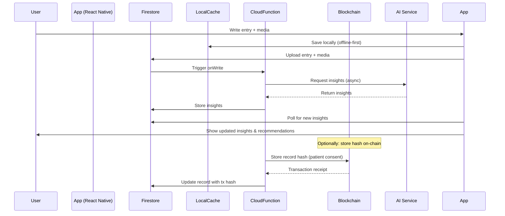

# 🧬 AI Health Journal – Complete Healthcare Personalization Platform

[](https://reactnative.dev/)
[](https://expo.dev/)
[](https://firebase.google.com/)
[](https://www.typescriptlang.org/)
[](https://opensource.org/licenses/MIT)
[](CONTRIBUTING.md)

**AI Health Journal** is a production‑ready, HIPAA‑inspired mobile application that empowers users to track their health, receive AI‑powered personalized insights, and maintain full control over their data using blockchain technology. Built with React Native (Expo), Firebase, and Solidity, it delivers a seamless, secure, and intelligent health journaling experience.

---

## 📖 Table of Contents

- [Overview](#-overview)
- [Key Features](#-key-features)
- [Architecture](#-architecture)
- [Tech Stack](#-tech-stack)
- [Project Structure](#-project-structure)
- [Getting Started](#-getting-started)
- [Environment Variables](#-environment-variables)
- [Running the App](#-running-the-app)
- [Backend Setup](#-backend-setup)
- [Smart Contracts (Blockchain)](#-smart-contracts-blockchain)
- [Machine Learning Models](#-machine-learning-models)
- [Testing](#-testing)
- [Deployment](#-deployment)
- [Contributing](#-contributing)
- [License](#-license)
- [Acknowledgments](#-acknowledgments)

---

## 🧠 Overview

The **AI Health Journal** is a comprehensive health tracking and personalization platform that combines:

- **Journaling** – Rich entries with text, photos, voice, and mood.
- **AI Insights** – Automated summarisation, sentiment analysis, and actionable recommendations.
- **Personalization** – Adaptive health goals, recommendations, and risk assessments.
- **Blockchain Security** – Patient‑controlled data access, immutable audit trails, and consent management.
- **Privacy & Compliance** – End‑to‑end encryption, zero‑knowledge proofs, and GDPR/CCPA readiness.

This project won **1st Place** in the Q‑munity Hack‑Q‑Thon and is designed to scale from a solo developer to an enterprise‑grade health platform.

---

## ✨ Key Features

| Feature | Description |
| :--- | :--- |
| 📓 **Rich Journal Entries** | Add text, photos, videos, voice notes, mood, activities, and tags. |
| 🤖 **AI Insights** | Automatic summarisation, sentiment analysis, and action‑item extraction from your entries. |
| 💪 **Health Score & Trends** | Track your overall health score, physical, mental, sleep, nutrition, and activity sub‑scores. |
| 🔥 **Streak Tracking** | Visualise your journaling consistency and celebrate milestones. |
| 🏥 **Personalized Recommendations** | Get actionable suggestions for sleep, exercise, nutrition, and mental wellness. |
| 🔐 **Blockchain Security** | Store health record hashes on‑chain with patient‑controlled access and immutable audit logs. |
| 🧾 **Consent Management** | Grant, revoke, and time‑bound access to your health data for providers. |
| 📊 **Analytics Dashboard** | View trends, correlations, and health score evolution over time. |
| 🔍 **Smart Search** | Full‑text search with filters for date, mood, activities, and tags. |
| 📤 **Export** | Download your journal as PDF, CSV, or JSON. |
| 🗣️ **Voice Journaling** | Record voice notes with automatic transcription (optional). |
| 📶 **Offline First** | All data is cached locally; syncs automatically when online. |
| 🔔 **Smart Notifications** | Daily reminders, streak alerts, and new insight notifications. |
| 🌐 **Multi‑user Demo Mode** | Pre‑populated demo data for interactive product demonstrations. |

---

## 🏗️ Architecture

The platform is built on a **microservices‑inspired** architecture with clear separation between frontend, backend, and blockchain layers.

```mermaid
flowchart TB
    subgraph Client["React Native Mobile App"]
        UI[User Interface Screens]
        Hooks[Custom Hooks]
        Services[Service Layer]
        Storage[AsyncStorage Cache]
    end

    subgraph Backend["Firebase Backend"]
        Auth[Authentication]
        Firestore[(Firestore Database)]
        Functions[Cloud Functions]
        StorageFS[Firebase Storage]
        Crashlytics[Crashlytics]
        Notifications[FCM / APNs]
    end

    subgraph AI["AI & ML Services"]
        LocalNLP[Local NLP (Fallback)]
        CloudAI[Cloud AI (OpenAI / Gemini)]
        RecommendationEngine[Recommendation Engine]
        AnalyticsEngine[Analytics Engine]
    end

    subgraph Blockchain["Blockchain Layer"]
        EVM[EVM Compatible Chain]
        SmartContracts[Smart Contracts]
        IPFS[IPFS / Decentralized Storage]
    end

    subgraph External["External Integrations"]
        Sentry[Sentry Error Tracking]
        Mixpanel[Analytics]
    end

    UI --> Hooks --> Services
    Services --> Storage
    Services --> Auth
    Services --> Firestore
    Services --> Functions
    Services --> StorageFS
    Services --> LocalNLP
    Functions --> CloudAI
    Functions --> EVM
    Functions --> SmartContracts
    Functions --> IPFS
    Services --> Crashlytics
    Services --> Sentry
    Services --> Mixpanel
    UI --> Notifications
    SmartContracts --> IPFS
```

### Data Flow (Journal Entry Creation)



### Smart Contract Interactions

```mermaid
classDiagram
    class HealthRecordFactory {
        +createRecord(ipfsHash, dataHash, recordType)
        +grantAccess(recordId, provider, expiry)
        +revokeAccess(recordId, provider)
        +viewRecord(recordId)
        +getAccessLogs(recordId)
        +verifyIntegrity(recordId, providedHash)
    }
    class PatientConsentManager {
        +grantConsent(grantee, dataType, duration, purpose, actions, hash)
        +revokeConsent(consentId)
        +isConsentActive(patient, grantee)
        +getActiveConsents(patient)
        +requestConsent(patient, dataType, purpose)
        +respondToRequest(requestId, approve, duration, actions, hash)
    }
    class AccessControlRegistry {
        +registerEntity(name, entityType, attributes)
        +verifyEntity(entity)
        +grantEntityRole(entity, role)
        +checkAttributeAccess(entity, attributeName, attributeValue)
    }
    class AuditTrail {
        +logAudit(action, resourceType, resourceId, details, signature)
        +anchorAuditTrail()
        +verifyEntry(entryId)
        +getMerkleRoot()
    }
    class DataOwnershipToken {
        +mintRecord(patient, recordType, dataHash, version)
        +transferRecord(tokenId, to, reason)
        +updateRecord(tokenId, newDataHash, newVersion)
        +getRecordMetadata(tokenId)
    }
    class ZeroKnowledgeVerifier {
        +submitProof(statementHash, proofData, claimType, keyId)
        +verifyProof(proofId, keyId)
        +createAgeProof(age, threshold)
        +verifyAgeProof(proofData, statementHash)
    }
```



---

## 🛠️ Tech Stack

| Layer | Technology | Purpose |
| :--- | :--- | :--- |
| **Frontend** | React Native (Expo) | Cross‑platform mobile app |
| | TypeScript | Type safety |
| | React Navigation | Navigation |
| | Firebase SDK | Authentication, Firestore, Storage |
| | AsyncStorage | Offline caching |
| | Expo Modules | Camera, audio, notifications, haptics |
| **Backend** | Firebase Cloud Functions | Serverless API, AI orchestration |
| | Firestore | NoSQL database |
| | Firebase Storage | Media storage |
| | Firebase Auth | User management |
| **AI & ML** | OpenAI / Gemini (optional) | Advanced insights and recommendations |
| | Local NLP (fallback) | Sentiment analysis, keyword extraction |
| | scikit‑learn (Python) | Health score, risk prediction models |
| **Blockchain** | Solidity | Smart contracts (EVM) |
| | Web3.js / ethers.js | Blockchain interaction |
| | IPFS | Decentralised storage for encrypted data |
| **DevOps** | Docker / Kubernetes | Container orchestration |
| | GitHub Actions | CI/CD |
| | Sentry / Crashlytics | Error monitoring |
| | Expo EAS | Build and deployment |

---

## 📁 Project Structure

```
HealthJournal/
├── .env.example
├── app.json
├── package.json
├── tsconfig.json
├── eas.json
├── firebase.json
├── backend/
│   └── functions/
│       ├── src/
│       │   ├── index.ts
│       │   ├── ai/
│       │   │   ├── aiEngine.ts
│       │   │   ├── promptTemplates.ts
│       │   │   ├── dataAggregator.ts
│       │   │   └── personalizationRouter.ts
│       │   ├── blockchain/
│       │   │   └── contractService.ts
│       │   └── compliance/
│       │       ├── hipaaValidator.ts
│       │       └── gdprCompliance.ts
│       ├── package.json
│       └── tsconfig.json
├── contracts/                         # Solidity smart contracts
│   ├── HealthRecordFactory.sol
│   ├── PatientConsentManager.sol
│   ├── AccessControlRegistry.sol
│   ├── AuditTrail.sol
│   ├── DataOwnershipToken.sol
│   └── ZeroKnowledgeVerifier.sol
├── ml/                                # Machine Learning models
│   ├── models/
│   │   ├── healthPredictor.py
│   │   └── personalizationModel.py
│   └── training/
│       └── train_personalization.py
├── src/                               # React Native source
│   ├── api/                           # Firebase, web3 clients
│   ├── components/                    # Reusable UI components
│   ├── context/                       # React Context providers
│   ├── core/                          # Types, constants, utils
│   ├── demo/                          # Mock data for demo mode
│   ├── errors/                        # Error handling module
│   ├── hooks/                         # Custom React hooks
│   ├── improvements/                  # AI enhancements, export, search
│   ├── models/                        # Data models (TypeScript)
│   ├── navigation/                    # Navigation stack
│   ├── screens/                       # Screen components
│   ├── services/                      # Business logic services
│   ├── theme/                         # Theme and design system
│   └── utils/                         # General utilities
├── deployment/
│   ├── docker-compose.yml
│   └── kubernetes/
│       ├── deployment.yaml
│       └── service.yaml
├── __tests__/
│   ├── unit/
│   ├── integration/
│   └── e2e/
└── README.md
```

---

## 🚀 Getting Started

### Prerequisites

- Node.js 18+ and npm / yarn
- Expo CLI (`npm install -g expo-cli`)
- Firebase CLI (`npm install -g firebase-tools`)
- Git
- Android Studio / Xcode (for native builds)

### Installation

1. **Clone the repository**

```bash
git clone https://github.com/yourusername/ai-health-journal.git
cd ai-health-journal
```

2. **Install dependencies**

```bash
npm install
cd backend/functions && npm install && cd ../..
```

3. **Set up environment variables**

Create a `.env` file in the root (copy from `.env.example`) and fill in your Firebase and API keys.

```env
# Firebase
FIREBASE_API_KEY=your_api_key
FIREBASE_AUTH_DOMAIN=your_project.firebaseapp.com
FIREBASE_PROJECT_ID=your_project_id
FIREBASE_STORAGE_BUCKET=your_project.appspot.com
FIREBASE_MESSAGING_SENDER_ID=your_sender_id
FIREBASE_APP_ID=your_app_id

# AI (optional)
OPENAI_API_KEY=your_openai_key
GEMINI_API_KEY=your_gemini_key

# Blockchain (for demo)
BLOCKCHAIN_RPC_URL=http://localhost:8545
CONTRACT_ADDRESS=0x...
```

4. **Set up Firebase**

- Create a Firebase project at [console.firebase.google.com](https://console.firebase.google.com/).
- Enable Authentication (Email/Password).
- Enable Firestore (start in test mode for development).
- Enable Storage.
- Enable Cloud Functions (Blaze plan required).
- Download your `google-services.json` (Android) and `GoogleService-Info.plist` (iOS) and place them in the appropriate folders (`android/app/` and `ios/`).

5. **Deploy Cloud Functions**

```bash
firebase deploy --only functions
```

6. **Run the app**

```bash
npx expo start
```

- Press `i` for iOS simulator, `a` for Android emulator, or scan the QR code with the Expo Go app.

---

## 🔐 Environment Variables

| Variable | Description |
| :--- | :--- |
| `FIREBASE_API_KEY` | Firebase Web API Key |
| `FIREBASE_AUTH_DOMAIN` | Firebase Auth Domain |
| `FIREBASE_PROJECT_ID` | Firebase Project ID |
| `FIREBASE_STORAGE_BUCKET` | Firebase Storage Bucket |
| `FIREBASE_MESSAGING_SENDER_ID` | Firebase Messaging Sender ID |
| `FIREBASE_APP_ID` | Firebase App ID |
| `OPENAI_API_KEY` | (Optional) OpenAI API key for advanced AI |
| `GEMINI_API_KEY` | (Optional) Google Gemini API key |
| `BLOCKCHAIN_RPC_URL` | RPC URL for blockchain (e.g., Ganache) |
| `CONTRACT_ADDRESS` | Deployed smart contract address |
| `SENTRY_DSN` | (Optional) Sentry DSN for error tracking |
| `DEMO_MODE` | Set to `true` to enable demo data |

---

## 📱 Running the App

### Expo Development

```bash
npx expo start
```

### Build for iOS (local)

```bash
npx expo run:ios
```

### Build for Android (local)

```bash
npx expo run:android
```

### Build for Production (EAS)

```bash
eas build --platform ios --profile production
eas build --platform android --profile production
```

### Submit to App Stores

```bash
eas submit --platform ios
eas submit --platform android
```

---

## 🔧 Backend Setup

### Firebase Cloud Functions

All backend logic is in `backend/functions/src/`. Key functions:

- `generatePersonalizedInsights` – generates AI insights using OpenAI/Gemini.
- `processHealthChat` – handles chat‑based health queries.
- `getPersonalizedRecommendations` – returns AI‑generated recommendations.
- `assessHealthRisks` – evaluates risk scores using ML models.
- `submitAIFeedback` – collects user feedback to improve AI.

Deploy functions:

```bash
firebase deploy --only functions
```

### Firestore Security Rules

Place the following in `firestore.rules`:

```
rules_version = '2';
service cloud.firestore {
  match /databases/{database}/documents {
    match /users/{userId} {
      allow read, write: if request.auth != null && request.auth.uid == userId;
      match /entries/{entryId} { allow read, write: if request.auth != null && request.auth.uid == userId; }
      match /insights/{insightId} { allow read: if request.auth != null && request.auth.uid == userId; allow write: if false; }
    }
  }
}
```

---

## ⛓️ Smart Contracts (Blockchain)

The blockchain layer provides immutable, patient‑controlled data ownership.

### Deploying Contracts (Local Ganache)

1. Install [Ganache](https://trufflesuite.com/ganache/) or run the Docker container.

2. Install Truffle or Hardhat:

```bash
npm install -g truffle
```

3. Compile and migrate:

```bash
cd contracts
truffle compile
truffle migrate --network development
```

4. Update the `CONTRACT_ADDRESS` in your `.env` file.

### Contract Overview

| Contract | Purpose |
| :--- | :--- |
| `HealthRecordFactory` | Creates and manages health records; stores IPFS hashes; controls access. |
| `PatientConsentManager` | Manages patient consent for data sharing; supports granular permissions and expiry. |
| `AccessControlRegistry` | Attribute‑based access control; assigns roles to entities (patients, providers, researchers). |
| `AuditTrail` | Immutable logging of all data accesses; Merkle‑root anchoring for verifiability. |
| `DataOwnershipToken` | ERC‑721 token representing each health record; transferable ownership. |
| `ZeroKnowledgeVerifier` | Verifies zero‑knowledge proofs (e.g., age verification without revealing exact age). |

---

## 🤖 Machine Learning Models

The `ml/` folder contains Python code for training health prediction models using scikit‑learn.

### Training the Models

```bash
cd ml
pip install -r requirements.txt
python training/train_personalization.py
```

This generates:
- `models/health_predictor.pkl` – Random Forest for risk classification.
- `models/rl_qtable.npy` – Reinforcement learning Q‑table for adaptive recommendations.

The models are used by Cloud Functions to enhance AI outputs.

---

## 🧪 Testing

### Unit Tests (Jest)

```bash
npm test
```

### Integration Tests (Firebase emulators)

```bash
firebase emulators:exec "npm run test:integration"
```

### End‑to‑End Tests (Detox)

```bash
npm run test:e2e
```

---

## 🚢 Deployment

### Expo EAS (App Store / Play Store)

- Configure `eas.json` with your build profiles.
- Run `eas build` and then `eas submit`.

### Backend (Firebase)

```bash
firebase deploy --only functions,firestore,storage,hosting
```

### Kubernetes (Production)

Apply the manifests in `deployment/kubernetes/`:

```bash
kubectl apply -f deployment/kubernetes/
```

### Docker Compose (Local Development)

```bash
docker-compose up -d
```

---

## 🤝 Contributing

We welcome contributions! Please read our [CONTRIBUTING.md](CONTRIBUTING.md) for guidelines.

### Development Workflow

1. Fork the repository.
2. Create a feature branch (`git checkout -b feature/amazing-feature`).
3. Commit your changes (`git commit -m 'Add amazing feature'`).
4. Push to the branch (`git push origin feature/amazing-feature`).
5. Open a Pull Request.

### Code Style

- TypeScript with strict typing.
- ESLint and Prettier are configured.
- Write unit tests for new features.
- Document all public APIs using JSDoc.

---

## 📄 License

This project is licensed under the MIT License – see the [LICENSE](LICENSE) file for details.

---

## 🙏 Acknowledgments

- **Q‑munity Hack‑Q‑Thon** – for the inspiration and award.
- **OpenAI** & **Google Gemini** – for AI capabilities.
- **Firebase** – for backend infrastructure.
- **React Native** community – for continuous support.
- All contributors and early testers.

---

## 📞 Support & Contact

- **GitHub Issues**: [Submit here](https://github.com/yourusername/ai-health-journal/issues)
- **Discord**: [Join our community](https://discord.gg/your-invite)
- **Email**: support@aihealthjournal.com

---

## 📚 Further Reading

- [Architecture Deep‑Dive](docs/architecture.md)
- [Smart Contract Documentation](docs/contracts.md)
- [AI Service Internals](docs/ai.md)
- [Privacy & Compliance](docs/compliance.md)
- [Demo Mode Guide](docs/demo.md)

---

*Made with ❤️ for a healthier future.*
